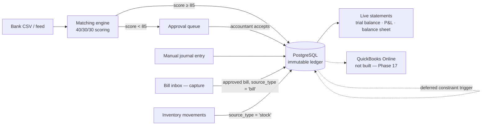

# Accounting — Module Spec & Build Ladder

> **Phase 33 (2026-09-25):** LedgerCore is now the **accounting module** of the single AutoLedger product — no longer an app with its own slug. Its API sits at the root of `/api/v1` (was `/api/v1/ledger-core`), its code in `*/accounting/` folders; its provenance tag stays `ledger-core` (see [architecture.md](architecture.md#product-structure)). The spec below keeps the original name where it records history.

**Provenance tag:** `ledger-core` · **Domain:** Core Accounting & Systems · **Phases:** 3–4, 6, 6.1, 8, 9b, 17, 24
**Status: Phase 3 through Phase 26, 30, 32 (step 1), 34 and 35a shipped (Phase 17 excepted).** The GL core is live — chart of accounts, journal entries, reversing entries, trial balance, with the balance invariant and immutability enforced by database triggers — LedgerCore has a front door (onboarding, settings, dashboard), a journal register with filters plus a per-account ledger with running balances and chart-wide rollups, navigation/confirmation UX (back links, collapsible chart, confirm-before-reverse), sales invoicing (customers, invoice settings, draft → issue → void posting a real balanced entry), accounts payable with settlement (vendors, a four-state bill approval workflow, payments against either invoices or bills, AR/AP aging reconciled to the GL), live financial statements (fiscal periods with a close/lock lifecycle and a database-enforced posting guard, plus P&L and the balance sheet, both computed from raw `ledger_lines` with no summary table), bank reconciliation (CSV statement import idempotent by dedupe hash, a hand-written 40/30/30 confidence-matching engine, an approval queue, a reconciliation report against the GL, and — Phase 6.1 — a direct journal posting for an unmatched line with no counterpart document), the multi-currency FX engine (exchange rates with a latest-on-or-before lookup, foreign-currency invoices/bills/payments, realized settlement gain/loss, and period-end unrealized revaluation with an automatic next-day reversal), a way in for a business migrating off another system (a staged chart-of-accounts importer, a staged opening-balance importer, and — Phase 24 — staged customer/vendor importers, all validated before one all-or-nothing commit), and — also Phase 24 — a selectable payment-terms catalogue that derives a document's due date and a product/service catalogue an invoice or bill line can be picked from, and — Phase 25 — a clickable account per customer and vendor (a subsidiary ledger under the AR/AP control accounts, with open items), plus a rule refusing manual journals to a control account. Phase 17 is unticked below — no QuickBooks sync. Keep this file verified against the filesystem, not against its own claims.

LedgerCore — now the accounting module — is the system of record. Capture and inventory do not keep their own ledgers — they post into this one through `journal_entries.source_type` / `source_id`, and read nothing of each other's tables ([guardrails.md](guardrails.md) rule 16).

The thesis it exists to demonstrate: **99% of bookkeepers cannot code, and 99% of engineers cannot explain a debit.** Everything below is chosen to sit on that seam — correct accounting, enforced by real engineering.

---

## Feature scope

### A. Enforced double-entry engine — Phase 3

- **Atomic zero-sum transactions.** Every financial event is at least two posting lines where `SUM(debits) − SUM(credits) = 0`. An unbalanced `POST` rolls the transaction back; nothing partial survives.
- **The invariant is enforced twice, at two layers.** `journalService` validates before writing, and a `DEFERRABLE INITIALLY DEFERRED` constraint trigger re-checks at `COMMIT`. The application being correct is not the reason the ledger balances — see [Why the trigger, given the service already checks](#why-the-trigger-given-the-service-already-checks).
- **Immutable append-only ledger.** No `UPDATE`, no `DELETE` on a posted entry — refused by trigger, not by convention, and there is no route that could offer one. Corrections are reversing entries carrying `reverses_entry_id` back to the original.
- **Multi-currency recorded from the first row.** Every line stores its native currency, the base-currency amounts, and the FX rate used on the transaction date. Phase 8 builds the engine that consumes this; Phase 3 refuses to write rows that would make Phase 8 impossible.

### B. Live financial statements — Phase 4

Computed by aggregation over raw `ledger_lines` on every request. **No pre-calculated summary tables, no nightly rollup job, no `account_balances` column that can drift from the lines it summarises.**

- **Trial balance** (Phase 3) — per-account debit and credit totals, type-aware `net_balance`, and an `isBalanced` flag that is integer equality.
- **Profit & Loss** — Revenue − Expenses, with gross profit split out via the `5xxx` COGS range.
- **Balance Sheet** — Assets = Liabilities + Equity, with current-period earnings folded into equity.
- **Fiscal periods** with close/lock, so a closed month cannot receive a late posting.
- ~~**AR/AP subledgers**~~ — delivered early, in Phase 3.9: `GET /reports/ar-aging`/`ap-aging`, receivable/payable detail reconciled to their control accounts.

### C. Bank reconciliation & confidence matching — Phase 6

- **Statement ingestion.** Messy real-world CSV exports: quoted fields containing commas and newlines, a BOM, inconsistent date formats, debit/credit in one signed column or two unsigned ones. Re-importing the same statement is idempotent via `UNIQUE (org_id, dedupe_hash)`.
- **Scoring engine.** Each bank line is scored against open AR/AP items out of 100:

  | Signal | Points | Rule |
  |---|---|---|
  | Amount | 40 | Exact integer-cent match |
  | Date | 30 | Within ±3 days of the document date, scaled by distance |
  | Counterparty | 30 | Levenshtein similarity on normalized name + memo |

- **Thresholds.** ≥85 is offered for one-click auto-reconciliation; anything below routes to the interactive approval queue. Every score stores its `score_breakdown` as JSONB, so a suggestion is explainable rather than a number the user is asked to trust.
- **Levenshtein is hand-written** in `utils/levenshtein.ts` — a rolling-array DP, `O(m×n)` time and `O(min(m,n))` space. No dependency, and the algorithm is one you can derive on a whiteboard.

### D. Multi-currency FX engine — Phase 8

- `fx_rates` keyed by `(base, quote, date)`, looked up as *the latest rate on or before* the transaction date — rate feeds have weekend and holiday gaps, so an exact-date match is a bug waiting for a Saturday.
- **Realized** gain/loss posted automatically on settlement, when the rate on the payment date differs from the rate on the invoice date.
- **Unrealized** revaluation of open foreign-currency balances at period end.

### E. QuickBooks Online sync — Phase 17

- OAuth 2.0 authorization-code flow, per-organization `realm_id`, tokens encrypted at rest and never logged.
- Push reconciled entries to `/v3/company/{realmId}/journalentry`.
- **Shipping honestly:** this phase is built against Intuit's documented API shape with `fetch` stubbed in tests. There is no sandbox account yet, so it lands as *wired, not verified against live Intuit*, and says exactly that until someone runs it against a real sandbox.

---

## The showcase items

### 1. Audit trail & internal controls — the CFO safety net — ✅ shipped, Phase 5

An append-only history stamping actor, timestamp, system source, and client IP on every financial write. The shared CDC trail is [Phase 5, as delivered](roadmap.md#phase-5-as-delivered); LedgerCore was its first consumer.

The mechanism worth explaining in an interview: **a Postgres trigger cannot see `req`.** It knows the row and the transaction, not who made the HTTP call. The actor reaches it through `set_config('app.current_user_id', $1, true)` and `set_config('app.client_ip', $2, true)` issued inside the same transaction (the function form, not `SET LOCAL` directly — only the function form accepts a bind parameter), read back by the trigger with `current_setting('app.current_user_id', true)`. The `true`/`is_local` flag scopes the value to the transaction, so a pooled connection handed to the next request carries nothing over. See [study/postgresql/audit-triggers-and-session-variables.md](../study/postgresql/audit-triggers-and-session-variables.md).

Alongside it, `npm run verify:integrity` — a standalone checker asserting total debits equal total credits across the entire database, that every entry balances individually, and that no line is orphaned. It is the script you run in front of an auditor, and `server/src/__tests__/integrity.test.ts` proves it is capable of failing. See [study/postgresql/integrity-checking-a-ledger.md](../study/postgresql/integrity-checking-a-ledger.md).

### 2. Multi-tenant chart of accounts

GAAP/IFRS account types with parent-child hierarchy — `1000 Assets → 1100 Current Assets → 1110 Operating Cash` — resolved with a `WITH RECURSIVE` CTE, cycle-checked before any re-parenting is accepted. Header accounts carry `is_postable = false` and are refused by trigger if anything tries to post to them.

Every organization gets its own copy of the [default chart](schema.md#default-chart-of-accounts) at registration, seeded inside the same transaction that creates the organization. Two organizations may both own account code `1110` and can never see each other's.

### 3. Realized FX — the worked example

An invoice raised for **$1,000 USD** on day 1 when USD/INR is **83.00**, settled on day 10 when it is **83.50**. Base currency is INR.

**Day 1 — invoice raised.** 1,000 × 83.00 = ₹83,000.

| Account | Debit | Credit |
|---|---|---|
| `1120` Accounts Receivable | ₹83,000.00 | |
| `4200` Service Revenue | | ₹83,000.00 |

**Day 10 — cash received.** The same $1,000 is now worth 1,000 × 83.50 = ₹83,500. The receivable was carried at ₹83,000, so ₹500 more came in than was booked.

| Account | Debit | Credit |
|---|---|---|
| `1110` Operating Cash | ₹83,500.00 | |
| `1120` Accounts Receivable | | ₹83,000.00 |
| `4910` Realized FX Gain | | ₹500.00 |

The entry balances because the FX line is what makes it balance — that is the whole point of the account. **Note the direction:** a *receivable* settled at a higher rate is a gain. The mirror case, the one in the original spec, is a $1,000 *payable*: you owe $1,000, booked at ₹83,000, and it costs ₹83,500 to clear, so you debit `6810 Realized FX Loss` ₹500. Same arithmetic, opposite sign, because a liability moves the other way.

All three amounts are `BIGINT` paise/cents. The rate is `NUMERIC(18,8)`. Nothing here is ever a float.

---

## Architectural differentiation

### Why the trigger, given the service already checks

Most applications enforce accounting rules in application code and describe that as "validated". It holds exactly as long as every write goes through that code path — and then someone writes a data-fix script, a migration backfills a column, an ORM bulk-updates, or a future module posts through a service that forgot a check.

A `DEFERRABLE INITIALLY DEFERRED` constraint trigger closes that off. It fires at `COMMIT` rather than per statement, so an entry's lines can be inserted one at a time without ever being transiently invalid, and it evaluates the same integer equality the service does. The result is that **an unbalanced entry cannot exist in the database**, regardless of what wrote it — including a hand-typed `INSERT` in `psql`.

That is the difference between a rule and an invariant, and it is worth being able to say out loud.

### Data flow

### Webhooks for financial events — Phase 7 ✅ delivered

Phase 7 is shared infrastructure, not one of LedgerCore's own phases (3–4, 6, 8–9 above) — but LedgerCore is the source of every event it fires, so the feature is recorded here too. An outbound, HMAC-signed notification fires when one of five things happens: an invoice is issued, a bill is approved, a payment is recorded, a fiscal period is closed, or an unmatched bank line exceeds a configurable threshold. This landed in Phase 7 and not earlier for a specific reason — rule 5 forbids post-`COMMIT` follow-up work inside the posting function. An HTTP call to a receiver cannot happen inside the transaction (it would hold the connection open on a network round trip, and a rollback could not un-send it), and firing it after `COMMIT` without a queue means a crash between the two silently loses the notification. The fix actually built is a transactional outbox: `outboxService.emitEvent` writes an event row on the *same* transaction client as the posting itself, and a separate background drain turns that row into a signed webhook delivery. Full detail: [roadmap.md#phase-7-as-delivered](roadmap.md#phase-7-as-delivered), [api.md](api.md), [study/architecture/transactional-outbox.md](../study/architecture/transactional-outbox.md).

---

## Build ladder

Deliverables per phase. Acceptance criteria are the bar for ticking the phase, not aspirations.

### Phase 3 — GL core

- [x] `utils/money.ts` — branded `Cents`, parsing and formatting, no floats
- [x] `zod` adopted; `src/schemas/` layer + `utils/parseBody.ts` bridging zod errors to `ApiError(400)`
- [x] `002_ledger-core_accounts.sql` — `accounts` with `parent_id`, `is_postable`
- [x] `accountService` — list (tree and flat), create, re-parent with cycle check, `seedDefaultChart`
- [x] Chart seeded inside `/auth/register`'s existing transaction
- [x] `003_ledger-core_backfill_chart.sql` — the seed for every organization created in Phases 1–2
- [x] `004_ledger-core_journals.sql` — `journal_entries`, `ledger_lines`, both deferred constraint triggers, `reject_mutation()`, the `is_postable` guard
- [x] `journalService.createEntry` — one `BEGIN…COMMIT`, every statement on the checked-out client
- [x] `POST /:id/reverse` — the only correction path
- [x] `reportService.trialBalance` — type-aware `net_balance`, integer `isBalanced`
- [x] `express-rate-limit` on `/auth/login` and `/auth/register` — debt carried since Phase 1
- [x] Tailwind v4 + `lucide-react`; accounts, journal-entry and trial-balance pages; first real entry in `client/src/apps/registry.ts`
- [x] Cross-tenant isolation test under `__tests__/accounting/`

**Acceptance ✅ — all verified.** A hand-written `INSERT` of two unbalanced lines in `psql` succeeds on both inserts and fails at `COMMIT`. An entry with zero lines and an entry with one line both fail at `COMMIT`. `UPDATE`/`DELETE` on `journal_entries` and `ledger_lines` raise `0A000`. `SELECT SUM(debit_cents) - SUM(credit_cents) FROM ledger_lines` returns `0`. A second organization's account id under the first organization's session returns `404`, not `403`. Covered by `__tests__/accounting/ledgerConstraints.test.ts`, which writes raw SQL rather than going through the service.

**One thing Phase 3 does *not* claim.** Every line is written in the organization's base currency at `fx_rate = 1`. The currency columns exist and are populated, but nothing converts anything yet — the FX engine is Phase 8.

### Phase 3.5 — onboarding, settings & dashboard

A half-step between the GL core and live statements. Renumbers nothing; every box below Phase 4 stays exactly where it was.

- [x] `005_ledger-core_settings.sql` — `ledger_settings` (one row per org, keyed by `org_id`), plus `UNIQUE (org_id, id)` on `accounts` so `cash_account_id` carries a composite FK rather than a plain one
- [x] `settingsService.completeOnboarding` — one transaction, idempotent (resubmitting overwrites, never 409s), writes `organizations.name`/`base_currency` via `organizationService.updateOrganization` on the same client
- [x] The base-currency lock — `422` if any `ledger_lines` row exists and the submitted currency differs from the current one
- [x] `dashboardService.dashboardSummary` — position, year-to-date/month-to-date performance, a 6-point gap-filled trend, recent entries, integrity — one `FILTER`-aggregate scan plus a `generate_series` scaffold, **no summary table**
- [x] `GET/POST/PATCH /settings`, `GET /reports/dashboard`, `PATCH /organizations` (platform layer)
- [x] Client: sidebar navigation (a thin wrapper over the shared, collapsible `AppSidebar` rail since Phase 31), onboarding wizard (3 steps), dashboard with a hand-rolled `TrendChart`, settings page, reports index (trial balance live, P&L/balance sheet marked "Phase 4")
- [x] Cross-tenant isolation tests for both `settings.test.ts` and `dashboard.test.ts`

**Acceptance ✅ — all verified.** A newly registered user picking LedgerCore is redirected to the wizard, never the chart of accounts; completing it once and reloading never shows the wizard again. `GET /settings` on a fresh organization returns `200` with `onboardedAt: null`, never `404`. Posting a journal entry after onboarding with a different base currency returns `422`; with the same currency, `200`. The dashboard's `trend` always has exactly 6 points, including months with no postings, at zero. Covered by `__tests__/accounting/{settings,dashboard}.test.ts`.

**What this phase does *not* claim.** `position.equationHolds` is not the Phase 4 balance sheet — it folds `currentEarningsCents` (Revenue − Expenses, all time) into the check by hand, because there is no period-end close to derive retained earnings from yet. No `fiscal_periods` row exists anywhere; `fiscal_year_start_month`/`_day` are a setting consumed in application code, not a table. The cash tile is `null` until an organization explicitly configures a cash account.

### Phase 3.6 — journal register & account ledger

A half-step, like 3.5. Renumbers nothing; every box below Phase 4 stays exactly where it was. **No migration** — every query here is served by tables and indexes Phase 3 already built.

- [x] `GET /journals` gains `page`/`limit`/`from`/`to`/`accountId`/`sourceType`/`q` filters, a shared predicate builder (`journalService.buildFilters`) so `totalCount` can never disagree with the returned page, and an `e.id DESC` pagination tiebreaker
- [x] Every `JournalEntry` gains `createdByName`/`createdByEmail` (denormalised from the platform `users` table), `reversedByEntryId` (the inverse of `reversesEntryId` — set on an original once it has been reversed), and `totalDebitCents`/`totalCreditCents`
- [x] `GET /accounts/:id/ledger` (new `accountLedgerService.ts`) — one postable account's opening balance, every line oldest-first with a running balance computed by a `SUM(...) OVER (...)` window function over the full filtered set (continues correctly across pages), period totals, closing balance, and the counterpart accounts on each entry. Header accounts refused with `422`
- [x] `GET /accounts/balances` — own and subtree-rollup balance for every account (including headers and inactive accounts), via a descendant-walking recursive CTE mirroring `wouldCreateCycle`'s ancestor walk in the opposite direction. Registered before `/:id` so `balances` is never matched as an account id
- [x] Client: `JournalEntryPage` split into `JournalsPage` (the register), `NewJournalEntryPage` (posting), `JournalDetailPage` (one entry — no edit/delete affordance, only Reverse); `AccountLedgerPage` (opening/closing balance tiles, filterable transaction table with a running balance); `AccountsPage` gains a balance column and links postable rows into their ledger
- [x] Cross-tenant isolation tests for all three: `journals.test.ts` (filter leakage, forged `orgId`), `accountLedger.test.ts` (another org's account id → `404`), `accounts.test.ts`'s new `describe('account balances')` (another org's balances stay zero)
- [x] Two study notes: [window-functions-and-running-totals.md](../study/postgresql/window-functions-and-running-totals.md) (new), extensions to [aggregating-a-ledger.md](../study/postgresql/aggregating-a-ledger.md), [recursive-ctes-and-hierarchies.md](../study/postgresql/recursive-ctes-and-hierarchies.md) and [routing-nested-and-dynamic-segments.md](../study/react/routing-nested-and-dynamic-segments.md)

**Acceptance ✅ — all verified.** `?from=`/`?to=`/`?accountId=`/`?q=` each narrow the register correctly and `totalCount` always matches the filtered page, asserted with a same-predicate pagination-stability test across 5 same-date entries. An account ledger's running balance continues correctly from page 1 into page 2 rather than restarting (asserted directly). A header account's `GET .../ledger` returns `422`; its `rollupBalanceCents` on `GET .../balances` still sums its whole subtree, and a leaf's rollup equals its own balance. `GET /accounts/balances` is not shadowed by `/:id`. 280 server tests (up from 230), 65 client tests (up from 51).

**What this phase does *not* claim.** No sequential, human-readable entry number (`JE-000123`) — the register shows the first 8 characters of the uuid instead; adding one needs a per-org sequence and a migration. A header account's balance rolls up; its *transaction list* does not — clicking a header still shows no ledger, by design. No CSV/PDF export. No fiscal periods, close/lock, P&L, or balance sheet — those are still entirely Phase 4.

### Phase 3.7 — ledger navigation and chart editing

A third half-step, client-only. **No migration, no new server route, no new dependency.**

- [x] Journal register gains a per-row Actions column (View, Duplicate, Reverse), replacing the date-cell link; Reverse offered only when neither a reversal nor already reversed, mirroring `JournalDetailPage`'s `canReverse` rule
- [x] Duplicate opens `journals/new?copyFrom=<id>`, seeding the post form once from an existing entry (effect + `seeded` latch, not a live binding) — the substitute for edit, which does not and will not exist
- [x] Trial balance's account name and the account ledger's Reference cell are now links, closing the navigation loop chart → ledger → entry → account
- [x] Chart of accounts gains a create form (`NewAccountForm`), reachable from a header button and an empty-chart prompt, posting to the already-existing `POST /accounts`

**Acceptance ✅ — all verified.** 79 client tests (up from 65); server suite unchanged at 280, confirming no server code moved.

**What this phase does *not* claim.** No client-side role gating — every action is shown to every member, and the server's `requireRole` is the only enforcement.

### Phase 3.8 — sales invoicing

A fourth half-step. **No renumbering** — Phase 4 is unaffected and unstarted. Two pieces of scope: the navigation/confirmation gaps left by 3.5–3.7, and LedgerCore's first AR source document.

- [x] `ConfirmDialog` gates reversing a journal entry (from both the register and the detail page), issuing an invoice, and voiding an invoice — a hand-rolled `role="dialog"` component, not `window.confirm`
- [x] `BackLink` on every drill-down page; a journal line's account **name** also links into its ledger; the chart of accounts' header rows collapse (`aria-expanded`), starting expanded
- [x] `006_platform_organization_tax_ids.sql` — `organizations.tax_number`/`business_number`, edited via the existing `PATCH /organizations`
- [x] `007_ledger-core_invoice_settings.sql` — `ledger_invoice_settings`: numbering (prefix/padding/counter), defaults (due days, tax rate, posting accounts), branding/disclosure. No seed row, same "absence means unconfigured" posture as `ledger_settings`
- [x] `008_ledger-core_customers.sql` — `customers`, retired via `is_active = false`, no DELETE route
- [x] `009_ledger-core_invoices.sql` — `invoices`/`invoice_lines`; `reject_issued_invoice_mutation()` (a `to_jsonb` row-diff permitting only the `ISSUED -> VOID` transition, touching only `status`/`voided_at`/`void_journal_entry_id`) and `reject_non_draft_invoice_line_mutation()` (absolute once the parent leaves `DRAFT`)
- [x] `010_ledger-core_invoice_lines_org_index.sql` — a same-phase guardrail-review follow-up adding the `(org_id, invoice_id)` index `invoice_lines` was missing
- [x] `journalService.createEntryOnClient`/`reverseEntryOnClient` — the existing posting/reversal logic minus its own `BEGIN`/`COMMIT`, taking the caller's transaction client, so `invoiceService` can post a real journal entry inside the *invoice's* own transaction
- [x] `utils/money.ts` gains `scaleCents` — money × a rational factor in exact `BigInt` arithmetic (basis points for tax, thousandths for quantity), half-up rounding; tax computed per line and summed, never on a pre-summed subtotal
- [x] `invoiceService.issueInvoice` — allocates the next number from a locked counter row, posts one balanced entry (debit receivable, credit each distinct revenue account, credit tax if any), never writes `journal_entries`/`ledger_lines` directly
- [x] `invoiceService.voidInvoice` — posts a reversing entry if `ISSUED`; no GL posting at all if still `DRAFT`
- [x] `/api/v1/customers` (4 routes), `/api/v1/invoices` (7 routes, including `/:id/issue` and `/:id/void`), `/api/v1/settings/invoicing` (2 routes) — full detail in [api.md](api.md)
- [x] Client: a `Create` menu in the rail; `InvoicesPage`, `NewInvoicePage` (create and edit, one page), `InvoiceDetailPage` (printable, honoring invoice-settings disclosure/branding), `CustomersPage`, `InvoiceSettingsPage`, a shared `SettingsTabs` strip
- [x] Cross-tenant isolation tests for every new module: `organizations.test.ts`, `invoiceSettings.test.ts`, `customers.test.ts`, `invoices.test.ts`; `invoiceConstraints.test.ts` proves both triggers via raw SQL, bypassing the service entirely
- [x] Three new study notes ([document-lifecycle-fsm.md](../study/architecture/document-lifecycle-fsm.md), [gapless-numbering-and-counters.md](../study/postgresql/gapless-numbering-and-counters.md), [accessible-dialogs-and-focus.md](../study/react/accessible-dialogs-and-focus.md)) plus extensions to [deferred-constraint-triggers.md](../study/postgresql/deferred-constraint-triggers.md) and [branded-types-for-money.md](../study/typescript/branded-types-for-money.md)

**Acceptance ✅ — all verified.** Issuing an invoice allocates a sequential number and posts a balanced entry (`sourceType: 'invoice'`) visible in the journal register; the receivable/revenue/tax split is correct for a mixed-tax-rate fixture; voiding an issued invoice posts a reversal and the trial balance stays balanced; a raw-SQL `UPDATE` on an `ISSUED` invoice's amount, or an `INSERT`/`DELETE` on its lines, raises `0A000`, while the `ISSUED -> VOID` transition succeeds when it touches only the permitted columns. 340 server tests (up from 280), 94 client tests (up from 84).

**What this phase does *not* claim.** No `PAID` status and no payment/cash-receipt document — an issued invoice's receivable never clears except by voiding, and the UI says so. No AR aging, no AR subledger *report* (Phase 4 still owns that), no PDF export, no multi-currency invoices (needs the Phase 8 FX engine), no fiscal-period posting lock, no audit trail (Phase 5, delivered since). **Payment recording and AR/AP aging landed in Phase 3.9, immediately below.**

### Phase 3.9 — accounts payable & payments

A fifth half-step. **No renumbering** — Phase 4 is otherwise unaffected. This phase pays off the "AR/AP subledgers" line item Phase 4's box below used to own; that box is now ticked here instead.

- [x] `011_ledger-core_vendors.sql` — `vendors`, the AP mirror of `customers` (plus `payment_terms`), retired via `is_active = false`, no DELETE route
- [x] `012_ledger-core_ap_posting_accounts.sql` — three nullable AP posting-account columns on `ledger_settings` (`payable_account_id`, `tax_input_account_id`, `default_expense_account_id`), each a composite FK to `accounts`
- [x] `013_ledger-core_bills.sql` — `bills`/`bill_lines`, a **four-state** FSM (`DRAFT`/`AWAITING_APPROVAL`/`POSTED`/`VOID`, plus a recall edge `AWAITING_APPROVAL -> DRAFT`) — entry and approval are separate acts of trust, gated to different roles server-side; `reject_posted_bill_mutation()` and `reject_locked_bill_line_mutation()` mirror invoices' pair, widened to two mutable states
- [x] `014_ledger-core_payments.sql` — `payments`/`payment_allocations`; a payment is born `POSTED`, never a draft. A **pair** of deferred constraint triggers: `assert_payment_allocations_complete()` (mirrors `journal_entries`' parent-completeness check) and `assert_no_overallocation()` (a genuinely cross-transaction invariant — allocations against one document, summed across every payment ever made against it, must never exceed its total); `reject_allocation_mutation()` makes `payment_allocations` insert-only with no carve-out at all
- [x] Settlement (`allocatedCents`/`amountDueCents`/`settlementStatus`) is **derived**, not stored — no `PAID` status, no paid-amount column on either `invoices` or `bills`; computed from `payment_allocations` on every read via `paymentService.allocatedCentsSubquery`, filtered to `POSTED` payments, so voiding a payment un-settles its documents with zero additional writes
- [x] `billService.approveBill`/`voidBill` and `paymentService.createPayment`/`voidPayment` reuse Phase 3.8's `journalService.createEntryOnClient`/`reverseEntryOnClient`; neither service writes `journal_entries`/`ledger_lines` directly
- [x] Phase 19 — `billService` exports two more `*OnClient` functions on the identical pattern: `createCapturedBillOnClient` (a DRAFT bill from pre-computed per-line net/tax, no `computeLineTotals` involved) and `approveBillOnClient` (`approveBill`'s posting body, extracted so a caller's own already-open transaction can drive it). AP-Flow's `postingService.ts` is their only consumer outside this file — a bill can now originate from a captured document, not only from a hand-entered form, without AP-Flow ever writing `bills`/`bill_lines`/`vendors` directly (rule 16). `vendorService.findOrCreateVendorByNameOnClient` is the matching addition on the vendor side
- [x] `/api/v1/vendors` (4 routes), `/api/v1/bills` (8 routes, `/:id/approve` gated `OWNER`/`ADMIN` only), `/api/v1/payments` (4 routes, no `PATCH`), `GET /reports/ar-aging` / `ap-aging` (5 buckets, per-counterparty rows, `reconciles` against the GL control account) — full detail in [api.md](api.md)
- [x] `GET /reports/dashboard` gains `receivables`/`payables`: outstanding/overdue totals, draft counts, and (payables only) the bill-approval queue's count/total
- [x] Client: `VendorsPage`, `BillsPage` (seven tabs mapped onto server `status`/`settlement` params), `NewBillPage`, `BillDetailPage`, `PaymentDialog` (shared by invoice and bill detail pages), `PaymentsPage`; `InvoicesPage`/`InvoiceDetailPage` gain the same settlement UI; `DashboardPage` gains two AR/AP panels with a hand-rolled `BarChart` (separate from `TrendChart`, not a generalization of it)
- [x] Cross-tenant isolation tests for every new module: `vendors.test.ts`, `bills.test.ts`, `payments.test.ts`, `aging.test.ts`; `billConstraints.test.ts`/`paymentConstraints.test.ts` prove the triggers via raw SQL, including that both deferred triggers fire at `COMMIT` and not at `INSERT`
- [x] Three new study notes ([derived-vs-stored-state.md](../study/architecture/derived-vs-stored-state.md), [subledger-reconciliation-and-aging.md](../study/postgresql/subledger-reconciliation-and-aging.md), [hand-rolled-svg-charts.md](../study/react/hand-rolled-svg-charts.md)) plus extensions to [document-lifecycle-fsm.md](../study/architecture/document-lifecycle-fsm.md), [deferred-constraint-triggers.md](../study/postgresql/deferred-constraint-triggers.md), and [aggregating-a-ledger.md](../study/postgresql/aggregating-a-ledger.md)

**Acceptance ✅ — all verified.** Approving a bill posts a balanced entry debiting each distinct expense account and crediting payable; an `ACCOUNTANT` attempting `/approve` is rejected with `403` at the route's role gate. Recording a payment posts a balanced entry and immediately reduces the target document's `amountDueCents`; voiding that payment restores it with no second write. A payment inserted with no allocations succeeds at `INSERT` and fails at `COMMIT`; a second payment allocating past a document's remaining balance succeeds at `INSERT` and fails at its own `COMMIT`, with a `SELECT ... FOR UPDATE` row lock (taken in `paymentService`, ahead of either transaction's deferred trigger) closing the race a purely deferred check alone would not. AR and AP aging both reconcile (`reconciles === true`) against their control accounts for a non-trivial fixture. 442 server tests (up from 340), 107 client tests (up from 94).

**What this phase does *not* claim.** No expense-claim/employee-reimbursement document — there is no such thing in AutoLedger; the bill-approval queue is unapproved vendor bills, not employee expenses. No credit notes, no vendor credits, no partial void *(credit notes and debit notes/vendor credits since shipped in Phase 26; partial void still not)*. No PDF export, no multi-currency invoices or bills (needs Phase 8), no fiscal-period posting lock, no audit trail (Phase 5, delivered since). Aging/overdue comparisons use UTC calendar dates, ignoring `ledger_settings.timezone`.

### Phase 4 — live statements

- [x] `fiscal_periods` with `EXCLUDE USING GIST` against overlap; close/lock transitions via an FSM table
- [x] Posting into a closed period rejected by trigger
- [x] `GET /reports/profit-and-loss`, `GET /reports/balance-sheet`, both date-ranged
- [x] ~~AR/AP subledgers reconciling to their control accounts~~ — delivered early, in Phase 3.9 (`GET /reports/ar-aging`/`ap-aging`)

**Acceptance ✅ — all verified.** The balance sheet satisfies Assets = Liabilities + Equity by integer equality for a fixture touching all three sections; `information_schema` confirms no summary table exists anywhere in the schema. P&L over a fiscal year and the balance sheet at that year's end agree: `netIncomeCents === equity.currentEarningsCents`. Two overlapping fiscal periods in one organization are rejected at `INSERT` with `23P01`; the identical overlap across two different organizations is permitted. A posting dated inside a `CLOSED` or `LOCKED` period is rejected with `422` through every path that reaches the GL — manual journals, reversals, invoice issuance — and independently by migration 016's trigger when the service is bypassed entirely with raw SQL. Locking a period that hasn't been closed is refused; reopening a `LOCKED` period is refused — the lock has no way out. 490 server tests (up from 442), 120 client tests (up from 107).

**What this phase does *not* claim.** No year-end closing journal entry — retained earnings on the balance sheet is derived (`SUM(revenue) − SUM(expense)` before the fiscal year start) and stays derived forever unless a closing-entry feature is added; an organization that manually posts its own closing entry into `3200` will see that year's earnings counted twice. Fiscal periods are monthly only — `period_number` is capped at 12 by CHECK, so quarterly or 4-4-5 calendars aren't representable. No per-period P&L drilldown, no PDF export, no audit trail (Phase 5, delivered since). Every date comparison here — period boundaries, `asOf`, `from`/`to` — uses UTC calendar dates, ignoring `ledger_settings.timezone`, the same limitation every other date-bounded report in this codebase already has.

### Phase 6 — bank reconciliation ✅ shipped

- [x] CSV parser surviving quoted commas, embedded newlines, BOM, and mixed date formats
- [x] Idempotent re-import via `dedupe_hash`
- [x] `utils/levenshtein.ts` — rolling-array DP, unit-tested against known distances
- [x] Scoring engine with stored `score_breakdown`
- [x] Approval queue UI; one-click accept above 85

**Acceptance ✅ — both verified.** The same statement imported twice yields one set of rows (`bankImports.test.ts`, named test). A known-good fixture of 100 bank lines scores with no false auto-reconcile above the threshold (`bankMatching.test.ts`, a deterministic 40-true-match/30-near-miss/30-noise fixture). See [Phase 6, as delivered](roadmap.md#phase-6-as-delivered) in the roadmap for full detail.

### Phase 8 — FX engine ✅ shipped

- [x] `fx_rates`, latest-on-or-before lookup
- [x] Realized gain/loss posted on settlement
- [x] Period-end unrealized revaluation

**Acceptance ✅ — verified.** The [worked example](#3-realized-fx--the-worked-example) reproduces exactly, to the paisa, in a named test: `fxRealized.test.ts`, `"reproduces docs/accounting.md's worked example to the paisa"`. See [Phase 8, as delivered](roadmap.md#phase-8-as-delivered) in the roadmap for full detail.

### Phase 9b — chart & opening-balance import

LedgerCore's way in for a business moving off another system. The platform half of Phase 9 — resumable, skippable onboarding — is specified in [roadmap.md](roadmap.md#phase-9-as-delivered).

- [x] `migration_imports` / `migration_import_rows` migration, with the partial unique index allowing one committed opening-balance import per organization
- [x] `3400 Opening Balance Equity` delta seed **and** backfill for existing organizations — the default chart becomes 45 accounts
- [x] Staged CSV import reusing `utils/csv.ts` and `parseMoneyText` — no new dependency. **`utils/dateParse.ts` is not used**: neither importer has a date column, so this deviates from the phase's original plan — recorded in [roadmap.md](roadmap.md#phase-9-as-delivered)
- [x] Every row stages, good and bad, with per-row errors and per-row fixes — **deliberately unlike** Phase 6's bank import, which aborts the whole file on any bad row
- [x] Chart commit: match on `code`, create unknown codes (parents resolved by parent *code*, depth-first as `seedDefaultChart` does), merge name/description only on known codes, error on a type conflict
- [x] `createAccountOnClient`, mirroring the existing `*OnClient` convention, so the commit runs on one transaction
- [x] Opening balances post **one** entry through `journalService.createEntryOnClient` at `books_start_date`, `source_type = 'opening_balance'` — never a direct `ledger_lines` write
- [x] Imbalance plugged to `3400`, shown in the preview before commit, never silently
- [x] `3200 Retained Earnings` refused — it is derived, and posting to it double-counts
- [x] The AR/AP control accounts refused — a lump receivable with no invoices makes `/reports/ar-aging`'s `reconciles` permanently false
- [x] Cross-tenant isolation test

**Acceptance ✅ — verified.** An unbalanced trial balance imports, commits with the difference sitting in `3400`, and `GET /reports/balance-sheet` still balances afterwards (`openingBalanceImport.test.ts`). A chart CSV with two deliberately corrupt rows stages the rest as `VALID` and commits only after both are fixed (`chartImport.test.ts`). A second opening-balance commit is refused by the index, not by the service — proven with a raw SQL statement bypassing `migrationImportService` entirely (`migrationImportConstraints.test.ts`). See [Phase 9, as delivered](roadmap.md#phase-9-as-delivered) in the roadmap for full detail.

### Phase 6.1 — bank line journal posting ✅ shipped

- [x] `POST /bank-transactions/:id/post-journal` — settles a line with no counterpart document by posting a balanced two-line journal entry, `sourceType: 'bank_line'`
- [x] Migration 057 replaces `chk_bank_txn_matched_fields` with an XOR over `matched_payment_id`/`matched_journal_entry_id`, and extends `reject_bank_transaction_mutation()`'s carve-out list for the new column
- [x] `unmatch` reverses the journal entry (never deletes it) exactly as it already voided a matched payment
- [x] `verify:integrity` gains a fourth check, `bank_line_journal_entries_exist`
- [x] `walkthrough/` at the repo root — a committed, three-month accounting scenario (vendors and customers imported via the Phase 24 party importer — `vendors.csv`/`customers.csv` — then vendor bills and customer invoices hand-entered, three bank statements in three different formats imported via the Phase 6 bank importer) with a computed answer key, verified end to end against these real services in `walkthrough.test.ts`. Run `npm run walkthrough` to regenerate it; see `walkthrough/README.md` and `walkthrough/TUTORIAL.md`

**Acceptance ✅ — verified.** A withdrawal posted through `/post-journal` debits the chosen account and credits the bank account, in a balanced entry (`bankLineJournal.test.ts`). Unmatching after a journal post reverses the entry and zeroes the GL balance it moved. Six new raw-SQL cases in `bankConstraints.test.ts` prove the XOR constraint holds regardless of what wrote the row. See [Phase 6.1, as delivered](roadmap.md#phase-61-as-delivered) in the roadmap for full detail.

### Phase 24 — payment terms, item catalogue, party import ✅ shipped

A direct feature request, not part of the strategic-plan sequence that named Phases 20–23 — see [roadmap.md](roadmap.md#phase-24-as-delivered) for why this is Phase 24.

- [x] `payment_terms` — org-owned, seven standards seeded at registration and backfilled for pre-existing organizations; a standard term's code/name/net-days are frozen, only `isActive` moves
- [x] `POST /invoices` and `POST /bills` accept an optional `paymentTermsCode`; the server derives `dueDate` from it when `dueDate` is omitted — an explicit `dueDate` always wins
- [x] The chosen term is **snapshotted** onto the document (`payment_terms_code`, `payment_terms`), never referenced by FK — a posted document must never be reachable by renaming or deactivating a term later
- [x] `items` — a catalogue (no inventory, no stock, no COGS), with an optional sale/purchase price, revenue/expense account and tax rate; `code`/`kind` frozen once created
- [x] `invoice_lines.item_id` / `bill_lines.item_id` — nullable, composite FK, `ON DELETE RESTRICT`; picking an item copies its defaults into the line **once**, the line never reads through to the item again
- [x] The Phase 9b staged importer extended with `CUSTOMERS`/`VENDORS` kinds — same staging/per-row-fix/preview/commit machinery, no second pipeline
- [x] Party import commit matches by lowercased email then lowercased name; a match merges only the `NULL` columns on the existing row, never overwriting data already there
- [x] A real bug (`org_id` FK mode on `payment_terms`/`items` copied from the wrong precedent) caught by `guardrail-review` and corrected forward with a new migration, not by editing the applied ones
- [x] Money-totals spacing fix across invoice/bill draft, detail and dashboard pages — presentation only
- [x] "Bill" relabelled "Expense" in the UI; `/expenses/*` routes added, `/bills/*` kept as aliases; schema/API/types/tests all still say `bills`
- [x] Four cross-tenant isolation tests (payment terms, items, line-item references, party import)

**Acceptance ✅ — verified.** An invoice created with `paymentTermsCode: 'NET_30'` and no `dueDate` gets `issueDate + 30` back (`paymentTerms.test.ts`). Picking `NET_30` on the invoice draft form fills the due date; hand-editing the due date afterward is not overwritten when the issue date then changes (`ledgerCorePaymentTerms.test.tsx`). Picking a catalogue item fills a line's description/price/account once, and the field stays editable afterward (`ledgerCoreItems.test.tsx`). A customer already in the system by name merges instead of duplicating on import, and a merge never overwrites an existing value (`partyImport.test.ts`). See [Phase 24, as delivered](roadmap.md#phase-24-as-delivered) in the roadmap for full detail.

### Phase 25 — customer & vendor accounts ✅ shipped

A direct feature request, numbered like Phase 24. See [Phase 25, as delivered](roadmap.md#phase-25-as-delivered).

- [x] No GL account per party. Each customer/vendor gets a subsidiary ledger under the one receivable/payable control account; the trial balance, P&L and balance sheet are unchanged
- [x] `GET /customers/:id/ledger` and `/open-items`, plus the same under `/vendors`. Control-account lines are attributed to a party through its documents' `journal_entry_id`/`void_journal_entry_id` (`partyLedgerService.ts`, no migration); one row per document event with a running balance, and payment rows carry the documents they settled
- [x] `POST /journals` and `POST /bank-transactions/:id/post-journal` refuse the AR/AP control accounts (`422`), the SAP reconciliation-account rule; document posting and reversals are unaffected
- [x] `PartyAccountPage` (balance due / overdue / open documents, open items, account ledger); customer and vendor names link to it, and the lists show a balance-due column

**Acceptance ✅ — verified.** For every customer and vendor, ledger closing balance = open-items outstanding, and the sum over parties = the aging report's total = the control account's GL balance (`partyLedger.test.ts`). Both 422s, the rollback, and the cross-tenant cases are covered in `controlAccountGuard.test.ts`.

### Phase 26 — credit & debit notes ✅ shipped

The two documents that correct a posted invoice or bill **without touching it**.

| Document | Issued by | Effect | Journal entry on issue | When you need one |
|---|---|---|---|---|
| **Credit note** | us → customer | AR ↓ | DR revenue (usually `4800 Sales Returns & Allowances`) + DR sales tax / CR `1120` AR | goods returned, a price allowance, a post-sale discount, damaged goods, part of an invoice wrongly charged |
| **Debit note** | us → vendor | AP ↓ | DR `2100` AP / CR the expense (or asset) account + CR input tax | goods returned to the vendor, an overcharge, a short delivery |

When you **don't** need one: the whole invoice was wrong and nothing was paid — void it; the customer will never pay — that's a bad-debt write-off (not built); the customer owes *more* — issue another invoice (the GST-sense "supplier debit note" that increases an invoice is not built).

- [x] Note references its original (invoice `ISSUED` / bill `POSTED`); party, currency and frozen `fx_rate` are copied from it — posting at the original's rate makes applying the note to it FX-neutral
- [x] DRAFT → ISSUED → VOID (`NOTE_TRANSITIONS`), DB-enforced immutability once issued; `CN-`/`DN-` gapless series allocated at issue
- [x] Issue auto-applies to the original up to the amount still due; the remainder is **unapplied credit** — a negative open item on the party's account and in AR/AP aging
- [x] Apply unapplied credit to another open document of the same party and currency — **posts no journal entry** (both already sit in the control account)
- [x] Cumulative cap (Σ issued notes ≤ original total) and settlement cap (payments + notes ≤ total), each enforced in the service under a row lock and by a deferred DB trigger
- [x] Settlement redefined once (`settlementSql.ts`): every amount-due computation subtracts applied notes as well as payments — invoice/bill reads, payment validation, bank-match candidates, FX revaluation, aging, party open items
- [x] An original cannot be voided while a note is issued against it or applied to it; voiding a note re-opens every document it settled
- [x] Walkthrough month 4 (`walkthrough/08-returns-and-adjustments.md`), replayed through the real API cent for cent

Full detail: [roadmap.md § Phase 26, as delivered](roadmap.md#phase-26-as-delivered), [api.md](api.md), [schema.md](schema.md#phase-26--credit--debit-notes-ledgercore--applied).

### Phase 30 — invoice templates, organization profile & settings tabs ✅ shipped

A direct feature request, outside the strategic-plan sequence, numbered like Phase 24. See [roadmap.md § Phase 30, as delivered](roadmap.md#phase-30-as-delivered).

- [x] `organization_profiles` (platform, migration `069`) — postal address, mailing address, phone, contact email, website, logo, and `legalName`/`industry` moved here from `ledger_settings` (which keeps the two columns, unedited, per rule 13); `GET`/`PATCH /organizations/profile`
- [x] **One renderer, two callers.** `InvoiceDocument.tsx` is a presentational-only component (no hooks, no fetch) extracted from `InvoiceDetailPage`'s inline markup and used unchanged by both the real invoice page and a new template editor's live preview — the structural decision the whole slice rests on. A characterisation test (`ledgerCoreInvoiceDocument.test.tsx`) pinned the untouched page's rendered output *before* the extraction, so the port is provably faithful
- [x] Three templates — `classic`, `modern`, `compact` — are a **closed set of code-defined layouts** selected by `templateId`, not a user-authored template language; `ledger_invoice_settings` gains `templateId`, `documentTitle`, `fontFamily`, `density`, `showLogo`, `showOrgAddress`, `showPaymentTerms`, `showDueDate`, `bankDetails` (migration `070`, 5 CHECK constraints)
- [x] `InvoiceTemplatePage` (`settings/invoice-template`) — editor left, sticky live preview right, fed entirely from local state against a fixed `SAMPLE_INVOICE`; no request fires on a keystroke or toggle
- [x] The logo reaches the browser as an object URL (`useDocumentObjectUrl`, wrapping the existing authenticated `downloadDocument`), never a bare `` — the access cookie is short-lived and the API origin differs from the client's
- [x] `/account` becomes five tabs (Organisation/Apps/Members/Session/System); `OrganizationProfilePanel` holds the address form and a two-step logo upload (`POST /documents` then `PATCH /organizations/profile { logoDocumentId }`) — an upload that succeeds but whose link-back fails leaves an orphaned, unreferenced document in the vault, the same accepted failure mode `documentService` already has on rollback
- [x] Three more LedgerCore settings tabs, **zero new server endpoints**: **Financial** (fiscal year start + a derived year-end line, books start date, default posting accounts, a read-only fiscal-periods count); **Chart of accounts** (an in-settings tree over the existing `listAccountTree`/`createAccount`/`updateAccount` — rename and retire only, never `code`/`type`, matching the existing "retype restates history" rule); **Conversion balances** (a Xero-style debit/credit grid, integer cents throughout, that serialises to the existing staged `OPENING_BALANCES` importer's CSV format rather than reimplementing validate/preview/commit)
- [x] The conversion-balances grid never offers Retained Earnings (code `3200`) or the AR/AP control accounts (the org's configured receivable account, or code `1120`; code `2100` for payable) as options — excluded from the `<select>`s outright, not select-then-refused, matching `openingBalanceImportService.loadRefusedAccounts`'s own exclusions
- [x] Cross-tenant isolation tests for both new server-side modules: `organizationProfile.test.ts`, `invoiceTemplate.test.ts`

**Acceptance ✅ — verified.** 1576 server tests (2 skipped, the same pre-existing gated live-provider cases) + 369 client tests (0 skipped), up from 1550/283 at Phase 29. A `guardrail-review` over the complete diff found zero violations.

**What this phase does *not* claim.** No user-authored template language (three code-defined layouts only) · no PDF export (still `window.print()`) · no logo on an AP-Flow or StockLedger document · no per-customer template override · no country picker (a typed 2-letter code) · no industry picker (free text) · no bulk chart import from the new Chart of accounts tab (that stays the staged importer's own page) · no conversion-balance commit UI of its own (`ConversionBalancesPage` hands off to the existing migration-import detail page for preview/commit). **Pre-existing, found in this phase, not fixed:** `ledger_invoice_settings.payment_terms` has no reader anywhere in the codebase — the editor deliberately has no field for it, since it would show in the preview and then print on no real invoice; a future cleanup should either wire it as a new-invoice default or drop the column.

Full detail: [roadmap.md § Phase 30, as delivered](roadmap.md#phase-30-as-delivered), [api.md](api.md), [schema.md](schema.md#phase-30--organization-profile--invoice-templates-platform--ledgercore--applied).

### Phase 17 — QuickBooks sync

- [ ] OAuth 2.0 authorization-code flow, encrypted token storage, refresh handling
- [ ] Journal entry push with idempotency
- [ ] `fetch` stubbed in tests; no live call in CI

**Acceptance:** the phase is marked done only with an explicit note stating whether it has been run against a live Intuit sandbox. "Wired" and "working" are not the same claim.

---

### Phase 32 — Products & Services and inventory posting (step 1)

A direct feature request, numbered like Phase 24. Full detail, rulings and gaps: [roadmap.md § Phase 32, as delivered](roadmap.md#phase-32-as-delivered).

- `items` is the one product master, shown as **Products & Services**, with `item_type` `SERVICE` / `NON_INVENTORY` (created in LedgerCore) and `INVENTORY` (created in StockLedger; `FIXED_ASSET` reserved). Services are created here; stock is created in StockLedger and appears here automatically. **Since 2026-09-30 the Products & Services form creates all three.** Ticking "Track inventory" routes the save to `POST /inventory/items`, with opening quantity and cost, and sets inventory up silently the first time. Ticking it on an existing `NON_INVENTORY` product converts it forward-only (`POST /inventory/items/from-product/:id`; `NON_INVENTORY → INVENTORY` is the one permitted item-type transition). Products are editable in place: prices, tax rates and accounts. See [inventory.md § One product form](inventory.md#one-product-form--2026-09-30).
- **Bill approval** — a line whose `item_id` is an `INVENTORY` product receives stock: Dr the item's inventory account (default 1140) instead of an expense account, at base-currency net value, split across lines with `allocateCents` so receipts equal the GL debit. **Invoice issue** — the same entry gains Dr Cost of Sales (default 5050) / Cr Inventory at the moving-average value StockLedger removes; short stock is a 409 and leaves a DRAFT with no number consumed. **Voids** reverse the stock: exact value for an invoice; original value (clamped, with a Dr Inventory / Cr 5400 variance entry) for a bill, refused if the received stock has since been issued.
- **Free text and quick add.** A line with no item ("Free text") is always legal and posts as before; the item picker also offers "＋ New product or service…" (services and non-inventory items only) to create one from the draft without leaving it.
- Account resolution for inventory posting: the item's own account → `ledger_settings` (`inventory_account_id`, `cogs_account_id`, `inventory_adjustment_account_id`, `stock_opening_account_id`) → the default chart code; every candidate checked for type and postability.
- The seam: `invoiceService`/`billService` call `services/inventory/documentStockService.ts` (the only StockLedger module LedgerCore imports) on their own transaction client, then build their own journal from the values it returns. Lock order: document row → stock balances (sorted) → invoice number → journal.
- Acceptance ✅ — `inventoryPosting.test.ts`, `documentConcurrency.test.ts`, `documentConstraints.test.ts`, `itemTypes.test.ts`; `npm run verify:integrity` passes all six checks including `stock_movements_reconcile_with_gl`.
- **Not built (step 2):** lot/serial items and fixed assets on document lines (422), credit/debit-note restocking, depreciation. Consumption issues (an expense-account choice on a manual issue) and inventory as a whole-account control account were both closed by Phase 35a below, not by this phase.

### Phase 34 — automation rules: bank rules and recurring documents ✅ shipped

A direct feature request, numbered like Phase 24/30/32. Full detail, rulings and gaps: [roadmap.md § Phase 34, as delivered](roadmap.md#phase-34-as-delivered).

**34a — bank rules.** A saved pattern — "memo contains STRIPE FEE, post to `6600 Bank Fees`" — that settles a matching bank line the way a human already could through `POST /bank-transactions/:id/post-journal`, without doing it by hand every time the same recurring line lands.

- [x] `bank_rules` (`priority`, `direction`, `memoContains`, an inclusive amount range on the line's absolute amount, an optional bank-account scope, `targetAccountId`, `description`, `isActive`) — `GET`/`POST /bank-rules`, `PATCH /bank-rules/:id`, `POST /bank-rules/apply`
- [x] Deterministic matching only, no scoring, no learning (`utils/bankRuleMatch.ts`'s `findMatchingRule`) — lowest `priority` wins, ties break on the older rule
- [x] **A document suggestion at or above `AUTO_MATCH_THRESHOLD` (85) always wins over a rule** — rules only settle lines a real invoice/bill match did not already claim
- [x] Applied automatically at the end of every `POST /bank-imports`, and on demand via `POST /bank-rules/apply` for lines imported before the rule existed
- [x] Each candidate line runs inside its own `SAVEPOINT`; a rule whose posting is refused (a closed period, the Phase 25 control-account guard) rolls back just that line and leaves the rest of the import to commit — see [study/postgresql/transactions-isolation-pooling.md](../study/postgresql/transactions-isolation-pooling.md)
- [x] `unmatch` reverses a rule-settled line exactly as it already reversed a manually-posted one, clearing `matchedRuleId`
- [x] A rule is never deleted, only `isActive: false` (a settled line's FK to it is `ON DELETE RESTRICT`)
- [x] Cross-tenant isolation: another org's rules never see or settle this org's lines; a rule cannot target another org's account

**34b — recurring documents.** An invoice, bill or manual journal entry becomes a template; a background sweep generates the next occurrence on schedule, exactly once per due date.

- [x] `recurring_schedules` / `recurring_runs` — `kind` (`INVOICE`/`BILL`/`JOURNAL`), `frequency`/`intervalCount`, `startDate`/`endDate`, `mode` (`DRAFT`/`POST` — a `JOURNAL` schedule is always `POST`), `autoReverse` (`JOURNAL` only — reverses the generated entry on the first day of the next month)
- [x] Occurrence dates are always computed from the schedule's **anchor** `startDate`, never the previous occurrence, so a 31st-of-the-month schedule never drifts to the 28th (`utils/recurrence.ts`)
- [x] Exactly-once generation, two layers deep: `recurring_schedules ... FOR UPDATE SKIP LOCKED` before generating, plus `UNIQUE (schedule_id, run_date)` as a second line of defence — see [study/architecture/recurring-schedules-and-exactly-once-jobs.md](../study/architecture/recurring-schedules-and-exactly-once-jobs.md)
- [x] A BullMQ scheduler (`recurring-sweep`, every 15 minutes) enqueues one `recurring-generate` job per due schedule — the same sweep-then-per-entity-job shape Phase 19.3's Drive intake introduced; a schedule that falls behind catches up at most 12 occurrences per sweep tick
- [x] `GET`/`POST /recurring-schedules`, `POST /:id/pause`, `/resume`, `/end`, `/run`; pause → resume skips any occurrence that fell due while paused rather than generating a backlog
- [x] A closed fiscal period (or any other posting failure) records `lastError` on the schedule and generates nothing for that occurrence — not retried automatically, no document and no `recurring_runs` row left behind
- [x] A journal template must be a base-currency `manual` entry, not itself a reversal, and clears the Phase 25 control-account guard on every account it posts to
- [x] There is no `PATCH` and no `DELETE` — to change a schedule, end it and create a new one; a schedule with any run history cannot be deleted (`ON DELETE RESTRICT`)
- [x] `MakeRecurringDialog`, opened from an invoice, bill or journal entry's detail page; one `/recurring` page (not three separate nav entries) with a kind filter

**Acceptance ✅ — verified.** 1673 server tests (2 skipped, the same pre-existing gated live-provider cases) + 439 client tests, up from 1610/428 at Phase 33. `npm run verify:integrity` passes all six checks. A guardrail review over the complete diff found zero violations. A real bank statement settles a matching fee line by rule; running a recurring invoice's `run` action twice on the same day generates exactly one draft, not two — both proved against the real API, not just unit-tested.

**Not built:** rules that match a party or split a settlement across several accounts; rules learned automatically from posting history; recurring credit/debit notes; editing a schedule in place; emailing a generated invoice; catch-up beyond 12 occurrences in one sweep tick.

### Phase 35a — inventory as a control account

A direct feature request, numbered like 24/30/32/34, closing the three items Phase 32 step 1 explicitly deferred: whole-account inventory reconciliation, a settings UI for the four inventory accounts, and consumption issues to a chosen expense account. Full detail, rulings and gaps: [roadmap.md § Phase 35a, as delivered](roadmap.md#phase-35a-as-delivered); the inventory-side mechanism: [inventory.md § GL reconciliation](inventory.md#gl-reconciliation--phase-35a).

- [x] An **inventory control account** is any `INVENTORY` product's `assetAccountId`, plus (only when some `INVENTORY` product has no override) the resolved default inventory account — a real per-organization set, checked by the 7th integrity check (`inventory_accounts_reconcile_with_gl`: Σ stock movements on the account = Σ its GL lines)
- [x] The reconciliation-account rule, extended a third time (AR, AP, now inventory): `journalService.assertNotControlAccountsOnClient` (manual journals, bank rules, recurring journals), the opening-balance importer, bill approval's free-typed-line guard, and debit-note create/update all refuse a posting to an inventory control account, `422`, naming it
- [x] A value-only movement pair, `RECLASS_OUT`/`RECLASS_IN` (`quantity_milli = 0`), moves an item's value between GL accounts without moving stock, whenever a product's or the settings default's mapping changes, or a void's reversal lands on an account no longer current — `stock_balances` untouched, one journal per reclass, `services/accounting/inventoryAccountingService.ts` the sole orchestrator
- [x] `GET /inventory/valuation`, `POST /inventory/reconcile/true-up` (moves the GL to the subledger, never the reverse), `POST /inventory/reconcile/reclass`, `POST /inventory/items/link-all`
- [x] `PATCH /settings` gains `inventoryAccountId`/`cogsAccountId`/`inventoryAdjustmentAccountId`/`stockOpeningAccountId`, each type/postability-checked in the same transaction as the write; changing `inventoryAccountId` reclasses every defaulted product in the same transaction
- [x] A manual receipt's `purpose` (`OPENING`/`ADJUSTMENT`) and a manual issue's `expenseAccountId` pick the linked item's GL counter-account
- [x] Migration `076` — the two new movement types, the append-only `stock_gl_true_ups` table, and a backfill repairing pre-35a linked items whose opening journal recorded no movement
- Acceptance ✅ — `inventoryControlAccount.test.ts`, `inventoryReconciliation.test.ts`, `inventoryValuation.test.ts`, `reclassConcurrency.test.ts`; `npm run verify:integrity` passes all 7 checks. 1708 server tests (2 skipped) + 451 client tests (0 skipped), up from 1673/439.
- **Not built:** class/category-level sub-accounts (35b), bills of materials/production orders (35c), NRV write-downs/credit-note restocking/landed cost (35d), valuation still in processing order not `occurred_on`.

### Phase 36 — CSV import throughout (36a foundation, 36b products & inventory items, 36c journals, 36d invoices & bills) — complete

A direct feature request, numbered like 24/30/32/34/35a. Phase 36 is four steps and **all four are built** (36d: open and historical invoices and bills, with a commit-time draft/post choice and a conversion mode). 36a adds **no new import kind** — it rebuilds the four existing ones on shared machinery; 36b adds the first two JSONB-staged kinds, `ITEMS` and `INVENTORY_ITEMS`; 36c adds the first grouped kind, `JOURNALS`; 36d adds `INVOICES` and `BILLS`. Full detail: [roadmap.md § Phase 36a, as delivered](roadmap.md#phase-36a-as-delivered), [§ Phase 36b](roadmap.md#phase-36b-as-delivered), [§ Phase 36c](roadmap.md#phase-36c-as-delivered) and [§ Phase 36d](roadmap.md#phase-36d-as-delivered).

- [x] **Kind registry** — `services/accounting/importKinds.ts` holds one `ImportKindDef` per kind (`satisfies Record<MigrationImportKind, ImportKindDef>`): column metadata (key, template header with a leading `*` when required, synonyms, note, example), `requiredOneOf`, per-column 422 text, editable row fields, and the parse/validate/preview/commit handlers. `migrationImportService` dispatches through `getImportKind`; the per-kind if/else chains and synonym arrays are gone. Row parsers moved to `importRowParsers.ts`, keyed by column key.
- [x] **Column resolution** — `utils/importColumns.ts` (pure): `compactHeader`, `resolveColumnIndexes` (explicit `columnMap` first, then template header, then synonyms; a file column feeds at most one field), `findMissingRequired`.
- [x] **Server-driven templates** — `GET /migration-imports/kinds`; `importTemplates.ts` on the client only builds a CSV from that metadata.
- [x] **Inspect, then stage** — `POST /migration-imports/inspect` reports headers, sample rows, a suggested map and what is missing without persisting; `POST /` accepts the chosen `columnMap`.
- [x] **Commit hardening** — commit locks the import row `FOR UPDATE` inside its transaction (two concurrent commits: one 200, one 409), persists `result`, and revalidation is one batched `UPDATE ... FROM unnest(...)` instead of one per row. One import takes at most `MAX_IMPORT_ROWS = 5000` data rows.
- [x] Account-type aliases widened (Xero/QuickBooks names such as Bank, Direct Costs, Overhead, Other Income); customer/vendor files also resolve `Contact Name` and `PO/SA Address Line 1`.
- [x] **Client wizard** — `Pages/accounting/imports/`: Upload → Map columns → Review & fix → Commit (`ImportSteps`), a `ColumnMapper` shown only when the file is not an exact template match, a metadata-driven `ImportRowsTable` (paged 50 at a time), an `ImportGuidePanel` beside each screen and a migration checklist on the Imports page. `ImportButton` on Accounts, Customers and Vendors starts a locked-kind import and returns to the list (`?returnTo=`, validated by `safeReturnTo`).
- [x] Migration `078` — see [schema.md § Phase 36a](schema.md#phase-36a--staged-importer-foundation-accounting--applied).

**Behaviour changes to know about.** A chart file with no name column is now `422` (was: every row staged `INVALID`). A customer file's payment-terms column is still accepted (appended to the customer's notes as a `Payment terms: …` line) but is not part of the customer template. A file column can no longer fill two fields. **Copy duplication:** the client guide text (`imports/importGuides.ts`) restates server rules (merge semantics, refused accounts); the server's messages stay authoritative.

**Acceptance ✅ — verified.** Our own template uploads as an exact match and stages with no map; a foreign-header file resolves by synonym or explicit map; bad maps are `400`; 5001 rows is `422`; two concurrent commits produce one commit; another org's import is `404` on read, fix and commit (`importMapping.test.ts`, `importColumns.test.ts`, `importWizard.test.tsx`). The legacy `chartImport`/`openingBalanceImport`/`partyImport` tests pass unedited. **Not built in 36a:** products/items (36b, below), journals, invoices/bills import (36c–d).

#### 36b — products & services and inventory items (as delivered)

- [x] **`ITEMS` kind** (Products & Services) — columns in `importItemColumns.ts`, validate/preview/commit in `itemImportService.ts`. An unknown code is created through `itemService.createItemOnClient` (the extracted body of `createItem`'s transaction); a known code is filled through `fillMissingItemFieldsOnClient`, which sets only currently-`NULL` description, prices and accounts and never a name, type or tax rate (a blank tax rate is indistinguishable from 0%). `INVENTORY` and `FIXED_ASSET` are refused here and pointed to the inventory import.
- [x] **`INVENTORY_ITEMS` kind** — columns in `importInventoryItemColumns.ts`, service `inventoryItemImportService.ts`. Create-only: each row makes a stock item, its linked product and optional opening stock, posted through the inventory module's own `OPENING` receipt, so the GL, `stock_balances` and the seventh-check reconciliation all agree. Reference data (categories, units, locations, existing codes) and creation cross into inventory **only** through `documentStockService.ts` (rule 16); `grep -n "inventory/" server/src/services/accounting/inventoryItemImportService.ts` shows that one import.
- [x] **JSONB-staged rows** — `storage: 'data'` kinds parse each cell by type (`utils/importValues.ts`: money → cents, percent → basis points, quantity → milli-units, date by `dateFormat`, enum aliases; all integer arithmetic) into `migration_import_rows.data` and keep the trimmed text in `raw`; `importRowStore.ts` loads/marks rows. Row edits are `PATCH { values }`.
- [x] **`dateFormat`** (`ISO`/`DMY`/`MDY`) on create, with `inspect`'s `suggestedDateFormat`; the wizard shows a "Date format in your file" select for any kind with a date column and will not stage until one is chosen.
- [x] **Revalidate at commit** and a **pre-transaction `prepareCommit` hook** in `migrationImportService.commit`, a generic summary-based preview (`summary`, `warnings`) and two result shapes — see [api.md § Migration imports](api.md).
- [x] **Client** — Import buttons on Products & Services and Inventory → Items, two checklist steps (`products` after vendors, `stock` after opening balances), enum `<select>` editing for Type, a generic summary `<dl>` and warnings on the preview, and committed-result lines for both kinds.
- No migration (078 already admitted both kinds and carries `data`/`group_key`/`options`).
- Acceptance ✅ — `importValues.test.ts`, `itemImport.test.ts` (12 cases incl. cross-tenant), `inventoryItemImport.test.ts` (12 cases incl. integrity checks after an opening-stock import, all-or-nothing rollback and cross-tenant); the 36a and legacy import tests pass unedited except two approved fixture/assertion adjustments recorded in the roadmap. **1816 server tests (2 skipped) + 515 client tests** at landing.
- **Not built / known gaps:** lot- and serial-tracked opening stock (receive it under Stock movements); importing an existing product into tracking (use Track inventory on the product form); updating an existing inventory item; an `ITEMS` merge never changes names, types or tax rates; barcode collisions with existing stock are caught only at commit; the `parseMoneyText` quirk noted in the roadmap.

#### 36d — invoices and bills (as delivered)

- [x] **`INVOICES` and `BILLS` kinds** ("Expenses" in the UI) — columns and group keys in `importDocumentColumns.ts`; one resolution function, `documentImportCore.resolveDocumentsOnClient`, used by validation, preview and commit, so a document that previews clean is the document that commits; thin `invoiceImportService.ts` / `billImportService.ts`. Invoices group by `InvoiceNumber` (blank = one invoice per row), bills by vendor + the vendor's own invoice number. Contacts are matched by name among active customers/vendors and never created; a product's defaults fill blank description, price, tax rate and account.
- [x] **Commit-time choice** — `POST /migration-imports/:id/commit` takes `{ mode: 'DRAFT' | 'POST', postingDate? }`. Drafts are created through `createInvoiceOnClient` / `createBillOnClient`; posting then runs `issueInvoiceOnClient` / `approveBillOnClient` in the same transaction (the create-then-post path recurring documents already use), on one chosen date or each document's own. Preview takes the same options and blocks a posting date inside a closed or locked period. A failure in any document rolls the whole import back.
- [x] **Imported numbers are kept** — a draft may carry a reserved `invoice_number`; issue keeps it and allocates from the sequence only when there is none. Before creating anything the commit advances `ledger_invoice_settings.next_number` past the largest imported `<prefix><digits>` number (`GREATEST`, only ever up, under the settings row lock), so a later invoice cannot collide. A bill's number is the vendor's reference, unique per vendor.
- [x] **Conversion mode — how P&L stays whole.** Chosen when staging, for open items dated on or before the conversion date (`books_start_date`). Opening balances import AR and AP as lump sums with a plug to 3400 Opening Balance Equity; if the open invoices were also imported as ordinary revenue documents, the same sales would be counted twice in year-to-date P&L. In conversion mode each document posts on the conversion date with every line on **3400** instead of revenue/expense, tax forced to 0 and no products. AR (or AP) rises by the document total and 3400 takes the opposite side, which cancels the opening import's plug; revenue and expense are untouched. The document keeps its own issue and due dates, so ageing shows the real age of each item while the ledger shows it on the conversion date. The only change to the document services is an allowance for that single account id in `assertRevenueAccounts` / `assertExpenseAccounts`.
- [x] **Client** — Import buttons on Invoices and Expenses; a "conversion mode" checkbox on the wizard's map stage; on the detail page, radio groups "How to import" (drafts / post) and "Posting date" (each document's own / on this date), the preview re-fetched on change, a fixed note in place of the options for a conversion-mode import; Open invoices and Open expenses steps in the migration checklist; guides.
- No migration (078 already admits `INVOICES`/`BILLS` and carries `commit_options` and `options`); [schema.md](schema.md) is unchanged.
- Acceptance ✅ — `invoiceImport.test.ts` and `billImport.test.ts` (grouping, defaults, contact and header rules, existing numbers refused, draft keeps its number, a later manual issue keeps it, the sequence skips imported numbers, post issues/approves, closed-period preview block and commit rollback, conversion mode nets the opening plug with ageing on the original due date and P&L unchanged, mode/posting-date 400s, an inventory line receiving stock with the integrity checks passing, ACCOUNTANT refused, cross-tenant); every existing invoice, bill, credit-note, recurring and import test passes unedited. **1861 server tests (2 skipped) + 526 client tests** at landing, up from 1834/520.
- **Not built / known gaps:** discounts; negative lines and credit-note / debit-note import; automatic contact creation (import customers and vendors first); partial commit (a bad document rolls back the whole import); line-level lot/serial pre-checks (a lot- or serial-tracked product, or a short stock issue, is refused at commit, not at validation); a Xero `TaxType` with no percentage fails the percent rule and must be remapped; a 1000-document posted commit holds the invoice-number lock for its duration and has not been timed; a foreign-currency document posts at the rate on its posting date, as a manual issue does.

#### 36c — manual journals (as delivered)

- [x] **`JOURNALS` kind** — columns and the group key in `importJournalColumns.ts`, validate/preview/commit in `journalImportService.ts`. Many rows are one entry: grouped by `JournalNumber`, or by Date + Narration (Xero-style) when there is no number. Each entry is validated as a whole — at least two lines, integer-cent balance, postable non-control accounts, an open period — and posted through `journalService.createEntryOnClient` with `source_type 'migration_import'`, all entries in one transaction.
- [x] **Grouped-kind machinery** (reused by 36d) — a kind's `groupKeyOf` fills `group_key` at staging and again when an edit sends `values`; `GET /:id/rows` lists group by group; `POST /:id/rows/status` bulk-includes or bulk-excludes a whole group and re-validates; staging refuses more than `MAX_IMPORT_DOCUMENTS = 1000` groups; `signedMoney` is a money cell type that allows a negative.
- [x] **One refusal map** — `journalService.listControlAccountsOnClient` (receivable, payable, inventory control account id → exact message) now backs both `assertNotControlAccountsOnClient` (manual journals, same messages and precedence as before) and the import's validation; `fiscalPeriodService.periodStatusOnClient` is the non-throwing twin of `assertPeriodOpenOnClient`.
- [x] **Client** — an Import button on the Journals page, a group header row per entry in the review table with an Exclude/Include button, a Journals step ("Other journals (optional)") in the wizard checklist, and "Imported (CSV)" with a link back to the import on an imported entry's detail page.
- No migration (078 already admits `JOURNALS` and carries `group_key`).
- Acceptance ✅ — `journalImport.test.ts` (16 cases: grouping both ways, signed amount, unbalanced/single-line/mismatched-date, control-account refusal, closed period, commit posts entries with `sourceType 'migration_import'` and the trial balance still balances, regrouping on edit, bulk exclude, bulk-status 404/409, the 1000-journal cap, revalidate-at-commit, cross-tenant); the existing journal, control-account and period tests pass unedited. **1834 server tests (2 skipped) + 520 client tests** at landing, up from 1816/515.
- **Not built / known gaps:** imported journals cannot be made recurring templates (`recurringService` accepts `'manual'` only); no auto-reversing flag and no per-line description, tax or tracking columns; two different entries sharing a date and narration with no `JournalNumber` are merged into one (use a number); the group key truncates a narration at 200 characters; a 1000-entry commit is unmeasured (200 two-line entries commit well within the test timeout); open invoices and bills are 36d.

### Phase 40 — placeholders ✅ shipped

Xero-style placeholders: write `Rent for [Month] [Year]` once and every document made from that text says "Rent for October 2026". Full detail: [roadmap.md § Phase 40, as delivered](roadmap.md#phase-40-as-delivered).

**The placeholders.** Names are case- and space-insensitive (`[contact name]`, `[ContactName]`). Unknown bracket text (`[draft]`) is ordinary prose and is left as typed — never an error.

| Placeholder | Becomes | Offset | Where |
|---|---|---|---|
| `[Day]` | day of month, `10` | ±n days | everywhere |
| `[Week]` | ISO-8601 week number, `41` | ±n weeks | everywhere |
| `[Month]` | `October` | ±n months | everywhere |
| `[Year]` | `2026` | ±n years | everywhere |
| `[Date]` | `10 Oct 2026` | ±n days | everywhere |
| `[Contact Name]` | the customer or vendor | — | invoices, bills, credit/debit notes, statements |
| `[Organisation Name]` (also `Organization`) | your organization | — | everywhere |
| `[Due Date]` | `9 Nov 2026` | — | invoices, bills |
| `[Occurrence]` | the recurring run's number | — | invoices, bills, journals |
| `[Invoice Number]` | the invoice number (on a credit note, the original invoice's) | — | invoices, credit notes |
| `[Balance Due]`, `[Overdue Amount]`, `[Statement Date]`, `[Period From]`, `[Period To]`, `[Open Invoice Count]` | statement values | — | statements and statement emails |

- **The date is the document's own date** — issue date, bill date, entry date, statement date, or a recurring run's date — never "today", so neither the server's nor a browser's timezone can move `[Month]`.
- **Month and year offsets are independent**, as in Xero: in December, `[Month+1] [Year]` is "January 2026". Write `[Year+1]` yourself. Likewise `[Week]` can be 53 or 1 while `[Year]` still shows the calendar year.
- Month names are **English only**. Short dates abbreviate September as `Sept` (`3 Sept 2026`), as statement emails always have.
- **Escape:** `[[Month]]` is written out as a literal `[Month]` when the document is issued — never filled. (A recurring DRAFT keeps the double brackets until issue, so the second fill cannot expand it.) It works for any bracket text: `[[draft]]` → `[draft]`.

**When they are filled.**

- [x] **On issue / approve / post** — an invoice when issued, a bill when approved, a credit or debit note when issued, a manual journal entry when posted (it posts at creation). No placeholder ever reaches a posted document. A draft keeps what was typed, so editing it never loses a placeholder.
- [x] **Recurring generation** — each occurrence is filled against its run date and number. It starts from the template's text *as written*: issuing or posting a document keeps that text in `*_template` columns (migration `087`), so a schedule built from an issued invoice — or any journal — still says `[Month]` next time. A generated DRAFT is filled except `[Invoice Number]`, which waits for issue.
- [x] **Bill vendor reference** — `RENT-[Month]` is filled instead of getting the Phase 34b `-YYYY-MM-DD` suffix. If the filled reference is already taken for that vendor, a recurring run falls back to `<reference>-<run date>`; if that is taken too it records a 409 on the schedule (`lastError`). A manual approval never changes a reference silently: a taken one is a 409. A reference without placeholders keeps the Phase 34b suffix exactly as before. Several drafts for one vendor may share a reference that still has placeholders (`RENT-[Month]`, typed ahead for later months); uniqueness applies once approval fills it (migration `088`).
- [x] **Bank lines** — a description written on a bank rule or the "post journal" form (`Bank fee [Month]`) is filled against the line's date. The bank's own statement text never is.
- [x] **Template settings text** — the invoice template's title, bank details and footer notes, and the statement template's title and footer, are filled per document as it renders (they are shared settings, not stored per document). A draft invoice's notes and lines are previewed filled too.
- [x] **Statement emails** — the built-in templates now use `[Contact Name]`, `[Balance Due]` and so on. Saved templates in the Phase 39b `{{contact_name}}` syntax keep working (on statements only), the editor offers a one-click conversion, and an unknown `{{name}}` is still refused (422).
- [x] **Over-long results are refused, not truncated** — a filled line description over 500 characters, notes over 1000, a reference over 100, or a journal description over 500 is a 422 naming the field, and the whole issue/approve rolls back (an invoice number included).
- [x] **Not filled, on purpose:** imported invoices and bills posted by an import, bills posted by the Bill inbox (OCR text), bank statement text, payment-term labels, and every system-written journal description (`Invoice INV-1 — <customer>`).
- [x] An "Insert placeholder" picker on every field that takes them — invoice, bill and note notes and lines, the bill reference, the journal description, bank rules, the invoice and statement templates and the email templates — with a live preview and non-blocking "did you mean [Month]?" hints.
- [x] Cross-tenant isolation: names come only from the issuing organization; another organization's bills never count as a reference collision; another organization cannot issue or approve a draft (404).

**Not built:** localized month names (there is no organization locale setting to choose them by); placeholders in the invoice-settings `paymentTerms` field (stored but never rendered); editing a schedule's text without editing its source document. A Bill-inbox bill approved later by hand is filled like a typed one — only the inbox's own auto-post skips filling.

### Phase 41 — quotes (sales and purchase) ✅ shipped

An offer before the document that bills it: a **sales quote** to a customer becomes an invoice; a **purchase quote** (a vendor's prices, recorded, or a price-confirmation request we send them) becomes an expense (bill).

**The accounting position (GAAP / IFRS).**
- **A quote posts nothing.** It is not a transaction, so it never touches the general ledger, stock, or a frozen FX rate. Under IFRS 15 / ASC 606 step 1, a contract exists only once both sides have approved it — acceptance — and even then revenue is recognised when the performance obligation is satisfied, which this product records with the **invoice** (or, for purchases, the expense on the **bill**). So conversion creates a **draft** invoice/bill, and the journal entry is posted only when that document is issued/approved, through the existing posting code.
- **Foreign currency is indicative.** A quote may show an approximate base-currency total at the rate on its date (IAS 21 / ASC 830 measure a transaction at the rate on the *transaction* date, and the quote is not the transaction). The invoice/bill resolves and freezes its own rate on its own date — tested.
- **What was offered cannot change silently.** Once sent, the quote is frozen in the database (trigger), its party details are snapshotted, and its content is hashed. A change is a numbered **revision** (QU-000012 rev 2) that supersedes the sent one; the history stays.
- **Evidence of acceptance** is insert-only: the signer's typed name, their tick on the terms, time, IP, browser, and the hash of exactly what they saw. One response per quote, decided by a unique constraint. This is good commercial evidence of agreement; it is not a qualified electronic signature.
- **Numbering** is gapless per direction (`QU-`, `PQ-`), allocated at first send, so a deleted draft burns no number.

**Lifecycle** (`QUOTE_TRANSITIONS`): DRAFT → SENT → ACCEPTED → CONVERTED, with SENT → DECLINED / EXPIRED / VOID / SUPERSEDED and ACCEPTED → VOID. CONVERTED → ACCEPTED happens only when the draft invoice/bill is *deleted* (voiding an issued one leaves the quote converted — convert once). A sent quote past its validity reads EXPIRED at once and cannot be accepted; an hourly worker sweep records it.

- [x] Sales and purchase quotes in one table (`direction`), one set of pages, one router factory; separate permissions (`quotes.*`, `purchase_quotes.*`)
- [x] Manual creation: party, dates, currency, catalogue items, revenue (sales) or expense/asset (purchase) accounts, per-line tax, payment term, notes, terms
- [x] Send by email (hashed, revocable, one-live-link review URL) or mark as sent for print; record an answer received another way
- [x] Public page `/quote/:token`: read the frozen quote, accept (full name + accept-terms) or decline (optional reason); the sender is notified
- [x] Revisions with supersede; void with a reason; attachments (e.g. the vendor's PDF quote)
- [x] Manual conversion to a linked DRAFT invoice/bill; nothing posted until issue/approve; back-link shown on the invoice/expense
- [x] Database-enforced immutability, FSM parity, convert-once and direction-safe back-links; cross-tenant isolation tested

Full detail: [roadmap.md § Phase 41, as delivered](roadmap.md#phase-41-as-delivered), [api.md](api.md), [schema.md](schema.md#phase-41--quotes-sales-and-purchase-accounting--applied).

### Phase 43a — payment-term rules and default terms ✅ shipped

- [x] `payment_terms.rule`: `DAYS_AFTER_DATE`, `DAYS_AFTER_MONTH_END`, `DAY_OF_NEXT_MONTH`, `DAY_OF_CURRENT_MONTH` ("20th of next month"), computed by one pure UTC-only function (`utils/dueDate.ts`, mirrored on the client and kept in parity by `dueDateCases.json`)
- [x] Resolution when a document carries neither `dueDate` nor `paymentTermsCode`: customer/vendor default term, else the organization's sales/purchase default, else `422`. An inactive default is skipped; an explicit `dueDate` or code always wins. Recurring documents follow the same path
- [x] Defaults are FK-referenced (composite, RESTRICT); the document still **snapshots** the resolved code/label, so a later rename cannot reach a posted row
- [x] Onboarding sets both organization defaults to `NET_30`; the new-invoice/expense forms pre-fill them and stop the moment the user picks a term or types a due date
- Not built: discount terms ("2/10 Net 30"), per-customer day overrides

### Phase 43b — attachments and linked orders ✅ shipped

- [x] Files are uploaded to the Document Vault while drafting (unlinked) or chosen from it (`DocumentPickerDialog`, "Not yet attached" by default); on save they are linked inside the bill's/invoice's own transaction, so a bad document id rolls the whole save back
- [x] A bill references a purchase order and an invoice a sales order (`bills.purchase_order_id`, `invoices.sales_order_id`): same party, order `CONFIRMED` or `CLOSED`, settable while the document is a draft; omitted on update = unchanged, `null` = clear; set automatically when raised from an order. Posted documents are never changed
- [x] Attachments panels on credit notes, debit notes and orders (new attachable entity types)
- Not built: reading attachments of an order from its bill, backfilling the link on already-posted documents

### Phase 42 — quote follow-ups: orders, partial billing, deposits ✅ shipped

Closes the Phase 41 "not built" list, except a qualified e-signature. The accounting-relevant parts are orders and deposits; the rest is workflow.

**Settings, timezone, templates, verified email, PDF.** Quote prefixes, next numbers, default validity and default terms are editable in Settings → Invoices. Quote dates (validity, expiry, revision date, conversion default) use the organization's timezone (`ledger_settings.timezone`; an unknown zone is rejected on save); every other document keeps UTC "today". Quote emails use editable templates per direction with `[Quote Number]`, `[Quote Total]`, `[Valid Until]`, `[Quote Title]`. An org can require a signer to verify their email with a 6-digit code before accepting; the evidence records that the email was verified (email-possession evidence, **not** a qualified e-signature). A quote downloads as an A4 PDF (staff and recipient).

**Sales and purchase orders.** A quote (or a hand-made order) becomes an order `SO-`/`PO-`: `DRAFT → CONFIRMED → CLOSED | CANCELLED`, `CLOSED → CONFIRMED`. An order **posts nothing** and moves no stock. Invoices and bills are raised against it for part of each line's quantity (partial conversion): their lines carry `order_line_id`, billed quantity is derived from non-void linked lines, and it can never exceed the ordered quantity (service check under lock plus a deferred database trigger). Voiding an invoice or deleting a draft frees the quantity. An order with a live invoice cannot be cancelled. Cancelling an order does not revert the quote it came from.

**Deposits and prepayments (IFRS 15 contract liability).** On a CONFIRMED, base-currency order a **deposit invoice** (`kind = 'DEPOSIT'`) or **deposit bill** is raised, 0% tax, one line:

| Event | Sales | Purchase |
|---|---|---|
| Deposit invoice issued / bill approved | DR 1120 Accounts Receivable · CR **2130 Customer Deposits** | DR **1150 Supplier Prepayments** · CR 2100 Accounts Payable |
| Deposit paid | ordinary payment | ordinary payment |
| Deposit applied to the final invoice/bill (`source_type 'deposit_application'`) | DR 2130 · CR 1120 | DR 2100 · CR 1150 |
| Application voided | the reversing entry (keeps `source_type 'deposit_application'`) | same |

Customer deposits are a liability until the work is delivered, not revenue; supplier prepayments are an asset (a receivable-like claim on goods or services). Rules: only what has been **paid** (payment allocations) minus earlier applications may be applied; the amount cannot exceed the target's amount due; the target must have a line linked to the deposit's order; a deposit document with a POSTED application cannot be voided, and a payment that funds an applied deposit cannot be voided until the applications are voided; deposit documents are locked against draft edits. An application is a third settlement source beside payments and credit/debit-note allocations, defined once in `settlementSql.ts`, so aging, party ledgers, statements and reconciliation include it (AR control = Σ party open items = aging total still holds). A quote can carry `deposit_percent_bp`; converting it to an order creates the DRAFT deposit document, converting it straight to an invoice is refused.

- [x] Quote settings UI, org-timezone quote dates, editable quote email templates, verified-email acceptance, quote PDF
- [x] Orders with confirm/close/reopen/cancel, partial invoicing and billing with remaining quantities, a quote converting to an order
- [x] Deposit invoices and bills, application, void; party ledgers, aging and statements reconciled; cross-tenant isolation tested
- Not built: a qualified electronic signature (needs a trust-service provider); GST/VAT on advances (deposits carry 0% tax — flag this before using it where advances are taxed); foreign-currency deposits (refused); refund of an unapplied deposit (a cancelled order with a paid deposit leaves a 2130 balance; clear it with a manual journal — 2130 is not a control account); a goods-receipt / delivery-note document (stock still moves on the invoice/bill); non-Latin text in the PDF; a product-wide timezone; PDF attached to emails.
- Known gap: the staff PDF download (`downloadQuotePdf`) uses a plain `fetch` without `apiDownloadBlob`'s 401-refresh, so an expired access token fails the download until the page next refreshes its session.

Full detail: [roadmap.md § Phase 42, as delivered](roadmap.md#phase-42-as-delivered), [api.md](api.md), [schema.md](schema.md#phase-42--quote-follow-ups-templates-verified-email-orders-deposits-accounting--applied).

## Not built yet

**Phase 17** — everything above its unticked boxes: no QuickBooks sync.

- **Audit trail and `verify:integrity` are both shipped** — see the [showcase section above](#1-audit-trail--internal-controls--the-cfo-safety-net---shipped-phase-5), no longer a target description. This closes the compliance gap every earlier phase note in this file flagged.
- **Bank reconciliation is shipped** (Phase 6) — CSV import, the 40/30/30 confidence engine, the approval queue, and the reconciliation report all exist. **Posting a journal entry directly from an unmatched line, for a fee/interest/opening-capital line with no counterpart document, is also shipped** (Phase 6.1, `POST /bank-transactions/:id/post-journal`) — `IGNORE` remains for a line that should never reach the GL at all (e.g. a transfer to another of the organization's own accounts), while a line that genuinely moves cash but names no invoice or bill now settles by posting a balanced two-line entry, `sourceType: 'bank_line'`, reversible (never deletable) the same way a matched payment is. Still not built within Phase 6/6.1: a bank line settling more than one document (or several lines settling one) in a single match, and bank feeds/OFX/QIF/MT940 beyond CSV, and multi-currency statements.
- **The FX engine is shipped** (Phase 8) — `fx_rates` with the latest-on-or-before lookup, foreign-currency invoices/bills/payments, realized settlement gain/loss, and period-end unrealized revaluation with an automatic next-day reversal. Not built within it: an external rate-feed integration (rates are entered by hand or imported as a batch — `fx_rates.source` distinguishes them — but nothing calls out to a live provider), FX on bank matching (bank statements remain base-currency-only, a Phase 6 limit this phase does not lift), a currency on an *account* itself (a cash account's balance is reported in base currency even though it may have received lines in several currencies), and consolidation-style translation of a whole subsidiary's trial balance (this phase revalues open AR/AP balances, not a full set of books).
- **Credit notes and debit notes are shipped** (Phase 26). Not built within it: cash refunds of unapplied credit, a bad-debt write-off document, the GST-sense supplier debit note, applying a foreign-currency note to anything but its original, webhooks/PDF/email for notes, re-scoring bank suggestions when a note is issued after a statement import — see [Phase 26, as delivered](roadmap.md#phase-26-as-delivered).
- **Customer & vendor accounts are shipped** (Phase 25). Not built within it: a bad-debt write-off document (credit notes arrived in Phase 26), party tagging on journal lines, PDF statements, statements in the party's own currency, unapplied/on-account payments — see [Phase 25, as delivered](roadmap.md#phase-25-as-delivered).
- **Customer & vendor statements are shipped** (Phase 39):
  - Outstanding (true as-at) and Activity statements, a statement template, print and bulk print;
  - emailed statements with user-editable templates and a revocable public link;
  - Stripe card payment from that link, recorded as an ordinary receipt.
  - Not built within it: aging on as-at settlement, per-currency statements, PDF attachments, Stripe Connect, refunds, partial invoice payment, a sweep for PENDING intents, scheduled statement runs — see [Phase 39, as delivered](roadmap.md#phase-39-as-delivered).
- **Quotes are shipped** (Phase 41); its follow-ups — settings UI, org-timezone dates, editable emails, verified-email acceptance, PDF, orders with partial billing, and deposits — are shipped in [Phase 42](#phase-42--quote-follow-ups-orders-partial-billing-deposits--shipped). **Still not built:** a qualified e-signature (QES needs a trust-service provider), auto-conversion on acceptance.
- **Payment terms, item catalogue and party import are shipped** (Phase 24). Not built within it: discount/end-of-month terms ("2/10 Net 30" — net-days only; a discount needs a second term kind and a GL posting), any inventory mechanic on `items` *within Phase 24* (on-hand quantity, stock movement and COGS posting arrived in Phase 32 — see the Phase 32 section above; item-level reporting is still not built), an importer for anything other than customers and vendors (no contacts, no products, no opening AR/AP balances via this path). The UI-only "Expense" label is a deliberate half-measure, not a gap: the schema, API, types and every test still say `bills` — see [Phase 24, as delivered](roadmap.md#phase-24-as-delivered).

When a phase lands, tick its boxes and update [roadmap.md](roadmap.md), [api.md](api.md), [schema.md](schema.md) and `CLAUDE.md` in the same change. A doc that describes a feature which does not exist is the failure mode that killed the previous build ([guardrails.md](guardrails.md#appendix--lessons-from-the-discarded-build)).
